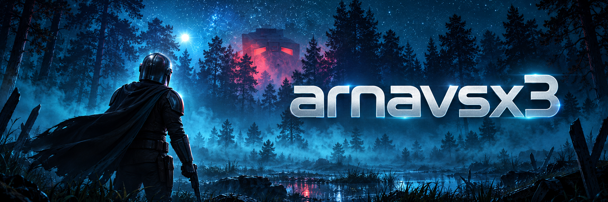

<h2>Hey! I'm Arnav.</h2>

I like to build cloud native apps and automate the pipelines that ship them.

<h3>The tools along the way</h3>

<a href="https://github.com/arnavsx3?tab=repositories">Explore my repos</a>
&nbsp; · &nbsp;
<a href="mailto:arnavsx3dev@gmail.com">Say hello</a>

