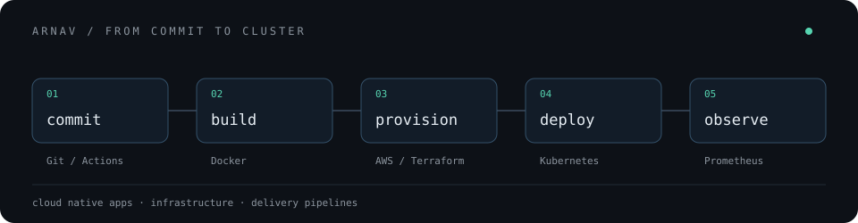

 
 

Hey! I'm Arnav. I like to build cloud native apps and automate the pipelines that ship them.

 

<samp>the tools along the way</samp>

 
 

 
 

<samp>
<a href="https://github.com/arnavsx3?tab=repositories">explore my repos</a>
&nbsp; / &nbsp;
<a href="mailto:arnavsx3dev@gmail.com">say hello</a>
</samp>

